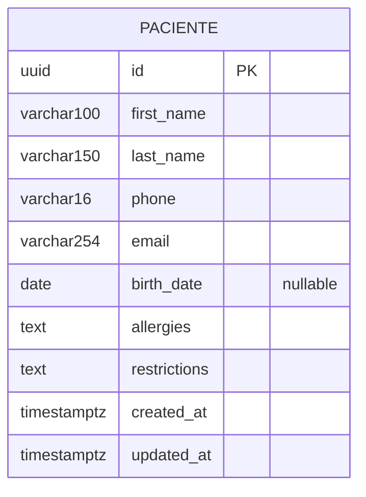

# Modelo lógico de datos — Sprint 1

**Propuesta v1 pendiente de aprobación.** Responsable: Diana. Issue #2.

El diagrama representa una única entidad de gestión básica y expediente. Las reglas exactas y nombres canónicos están en [DICCIONARIO_PACIENTE.md](DICCIONARIO_PACIENTE.md). UUID es una propuesta; no se ha creado una tabla ni una migración.

## Relaciones y límites

No hay relaciones entre entidades clínicas dentro del alcance autorizado de #2. Consultas y mediciones pertenecen a futuros Sprints; no se crean tablas vacías ni relaciones anticipadas. El nombre de tabla y de aplicación Django se confirmarán con Fernanda.

**Decisión pendiente de seguridad:** Fernanda y el orquestador deben definir si el expediente es compartido por usuarios autorizados o pertenece a un profesional. Si requiere propiedad, se debe justificar en #2 el campo adicional y acordar la relación al modelo de usuario (tipo de ID, nulidad, cardinalidad y política de eliminación) antes de implementar. Este diagrama no autoriza acceso global ni presupone aislamiento ya resuelto. Diana no implementa permisos.

## Consistencia que debe comprobar la migración posterior

1. Diez campos canónicos, una PK y ninguna unicidad adicional no acordada.
2. Solo la fecha de nacimiento admite NULL; textos opcionales usan cadena vacía.
3. Nombre, apellidos y teléfono son obligatorios según propuesta; timestamps los controla el servidor.
4. UUID, límites y CHECK coinciden con el diccionario aprobado y con el estado del modelo Django.
5. Aplicación limpia sobre PostgreSQL y ausencia de cambios pendientes en `makemigrations --check`.

La revisión documental no sustituye estas pruebas. Su ejecución queda pendiente de la aplicación de Fernanda y de la migración aprobada.
